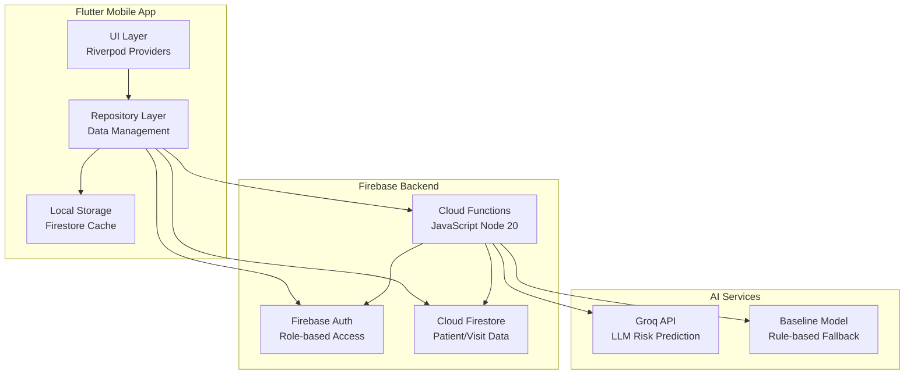
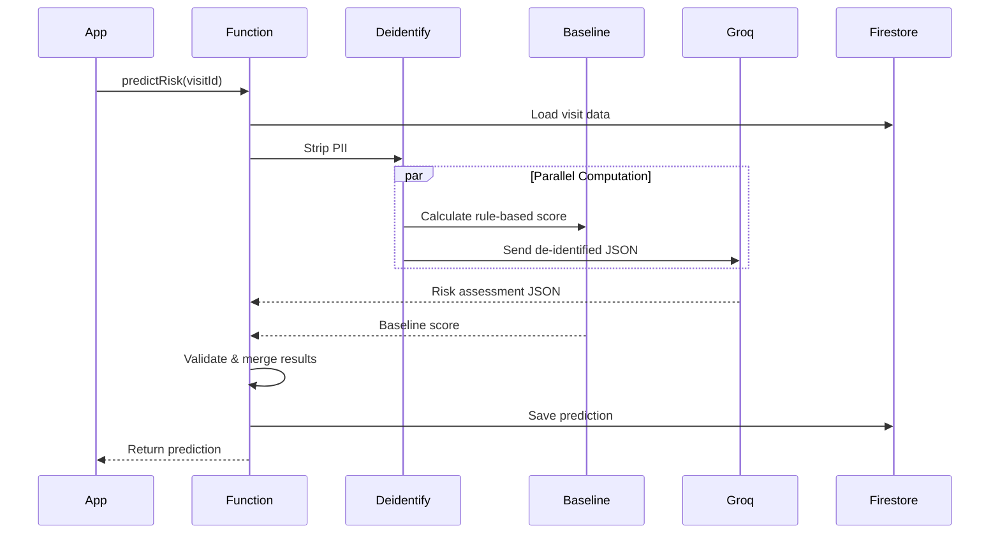

# System Architecture

## Overview

The Nsiika Health Centre IV Prediction App is a mobile-first clinical decision-support system that predicts adverse health consequences based on patient clinical data and health system factors.

## High-Level Architecture



## Component Details

### Flutter App (Client)

**Architecture Pattern**: Feature-first Clean Architecture lite

#### Core Layer
- **Theme**: Material 3 design tokens
- **Router**: go_router with auth guards
- **Constants**: App-wide constants and enums
- **Errors**: Custom exception types
- **Utils**: Helper functions and validators
- **Widgets**: Shared UI components
- **L10n**: Internationalization (English + Runyankole)

#### Features
Each feature follows this structure:
```
feature/
  data/
    models/          # Freezed models with JSON serialization
    repositories/    # Data access layer
  presentation/
    screens/         # UI screens
    widgets/         # Feature-specific widgets
    providers/       # Riverpod state providers
```

**Features**:
- **Auth**: Login, role management
- **Patients**: Patient CRUD, search
- **Visits**: Visit wizard (clinical + system factors)
- **Predictions**: Risk prediction display, feedback
- **Dashboard**: High-risk patients, facility status
- **Facility**: Daily staffing/stock-out entry
- **Admin**: User management, data export
- **Settings**: App preferences

### Firebase Backend

#### Firestore Collections

```
users/{uid}
├─ email, displayName, role, active, fcmTokens[], createdAt

patients/{patientId}
├─ internalCode, sex, birthYear, chronicConditions[]
├─ createdBy, createdAt, isSynthetic
└─ private/identity {fullName, phoneNumber, village, nin}

visits/{visitId}
├─ patientId, visitDate
├─ Clinical: complaint, vitals, triage, referral
├─ System: waitTime, staff, stockouts, shift
├─ actualOutcome[], outcomeRecordedAt
├─ predictionStatus, isSynthetic

predictions/{predictionId}
├─ visitId, patientId
├─ riskLevel, riskScore, consequences[]
├─ topFactors[], recommendations[]
├─ source, confidence, needsClinicianReview
├─ feedback{agreed, comment, by, at}

facilityDaily/{yyyy-MM-dd}
├─ staffOnDuty, patientLoad, stockouts[]

auditLogs/{id}
├─ actorUid, action, targetPath, metadata, at
```

#### Security Rules

- **Authentication required** for all operations
- **Role-based access**: clinician vs admin
- **Predictions write-protected**: Only functions can create
- **Feedback updates**: Staff can only modify feedback field
- **Audit logs**: Read-only for admins
- **Private patient data**: Restricted subcollection

#### Cloud Functions (JavaScript)

**Runtime**: Node.js 20, region: europe-west1

| Function | Trigger | Purpose |
|----------|---------|---------|
| `createUser` | Callable (admin) | Create user account + custom claims |
| `predictRisk` | Callable (staff) | De-identify data, call Groq/baseline, save prediction |
| `onVisitWritten` | Firestore trigger | Auto-predict when visit saved online |
| `onPredictionCreated` | Firestore trigger | Send FCM for high/critical risk |
| `exportValidationData` | Callable (admin) | Generate de-identified CSV for validation |

**Key Features**:
- Input validation with manual checks (no zod in JS version)
- Structured logging (no PII)
- Audit trail for sensitive operations
- Rate limiting (30 predictions/user/hour)
- Prediction caching (10 minutes by hash)

### AI Prediction Pipeline



#### De-identification Rules

**Allowed fields**:
- ageYears (NOT birthdate)
- sex, isPregnant
- chronicConditions (enum)
- vitals (numeric only)
- triageCategory, referralType (enum)
- presentingComplaint (scrubbed: no phone/NIN patterns, truncated to 300 chars)
- symptomDurationDays
- System factors: waitTime, referralDelay, staffOnDuty, patientLoad, stockouts, labAvailable, ambulanceAvailable, shift

**Blocked fields**:
- name, phone, village, NIN
- internalCode
- exact dates (only dayOfWeek and shift)
- any free-text with potential identifiers

#### Baseline Risk Model

Transparent weighted scoring:
```javascript
score = baseScore 
  + ageWeight(ageYears)
  + vitalsWeight(vitals)
  + pregnancyWeight(isPregnant)
  + chronicWeight(conditions)
  + triageWeight(category)
  + systemWeight(waitTime, staff, stockouts, shift, referral)
```

Outputs same schema as Groq for consistency.

#### Groq Integration

- **Endpoint**: OpenAI-compatible chat completions
- **Model**: llama-3.3-70b-versatile (check console.groq.com for latest)
- **Temperature**: 0.1 (consistency over creativity)
- **Response format**: JSON object
- **Timeout**: 20 seconds with 1 retry
- **Prompt version**: v1 (tracked in predictions)

### Data Flow

#### Online Visit Entry
1. Clinician enters visit data (Flutter)
2. Visit saved to Firestore (auto-synced)
3. App calls `predictRisk` function
4. Function computes prediction, saves to Firestore
5. App displays result in <2 seconds

#### Offline Visit Entry
1. Clinician enters visit (Flutter, offline mode)
2. Visit saved to local Firestore cache
3. `predictionStatus: pending` set
4. When connectivity returns, SyncService triggers
5. SyncService calls `predictRisk` for pending visits
6. Prediction syncs back to app

#### High-Risk Alert
1. Prediction created with `high` or `critical` level
2. `onPredictionCreated` trigger fires
3. Function queries on-duty clinicians
4. FCM sent to their devices
5. Notification: "High risk: patient NSK-XXXXX (visit today)"

## Technology Stack

### Frontend
- **Framework**: Flutter 3.12.2+ (Dart)
- **State Management**: Riverpod 2.x
- **Routing**: go_router
- **Code Generation**: Freezed, json_serializable
- **Charts**: fl_chart
- **Connectivity**: connectivity_plus

### Backend
- **BaaS**: Firebase (Firestore, Auth, Functions, FCM, Crashlytics)
- **Functions Runtime**: Node.js 20, JavaScript
- **AI**: Groq API (LLM inference)

### Development
- **Version Control**: Git
- **Testing**: flutter_test, jest (functions), firebase-functions-test
- **Linting**: flutter_lints
- **CI/CD**: GitHub Actions (planned)

## Offline Support

### Strategies
1. **Firestore offline persistence**: Enabled by default
2. **Local-first writes**: All data entry works offline
3. **Background sync**: SyncService retries pending operations
4. **Graceful degradation**: Show baseline prediction if Groq unavailable
5. **Clear status indicators**: Offline banner, pending chips

### Sync Priority
1. Visit creation
2. Prediction requests
3. Feedback updates
4. Facility daily data

## Security

### Authentication
- Firebase Auth with email/password
- Custom claims for roles (clinician, admin)
- No self sign-up (admin creates accounts)

### Authorization
- Firestore rules enforce role-based access
- Functions validate role from ID token
- Private patient data in restricted subcollection

### Data Protection
- PII never sent to external APIs (Groq)
- Audit logs for sensitive operations
- No secrets in source code (Firebase secrets)
- HTTPS only (enforced by Firebase)

### Privacy Compliance
- Uganda Data Protection and Privacy Act, 2019
- Data minimization principle
- Access control and audit trails
- De-identification for analysis/export

## Scalability Considerations

### Current Design (Small Pilot)
- Single Firebase project
- Single region (europe-west1)
- Firestore in Native mode
- Functions: 512MB memory, 60s timeout

### Future Scaling (if needed)
- Firestore indexes for complex queries
- Function batching for bulk predictions
- Groq rate limiting and caching
- Multi-region deployment
- CDN for static assets

## Deployment Architecture

```
Development → Firebase Emulators
    ↓
Staging → Firebase Project (Test)
    ↓
Production → Firebase Project (Live)
    ↓
Mobile Devices ← APK Side-loading
```

## Monitoring and Observability

### Logs
- Cloud Functions: Structured JSON logs
- Flutter: firebase_crashlytics + custom logger
- No PII in any logs

### Metrics
- Firebase Console: Functions invocations, errors, latency
- Firestore: Read/write/delete counts
- Crashlytics: App crash reports
- Custom: Prediction accuracy, feedback rates

### Alerts
- Budget alerts (Firebase billing)
- Function error rate thresholds
- Firestore quota approaching limits

## Testing Strategy

### Unit Tests
- Dart: Model serialization, validators, repositories
- JavaScript: De-identification, baseline model, auth

### Widget Tests
- Login, visit form, risk card, dashboard

### Integration Tests
- End-to-end: Login → Create patient → Create visit → View prediction
- Uses Firebase Emulators

### Rules Tests
- Firestore security rules with @firebase/rules-unit-testing

### Validation Tests
- Model evaluation: sensitivity, specificity, AUC
- Usability: SUS questionnaire with health workers

## Performance Targets

- Visit form save: <500ms (offline)
- Prediction latency: <5s (online)
- App cold start: <3s
- Dashboard load: <1s (cached)
- Offline mode: Full data entry functionality

## Constraints

- Rural internet: Weak/intermittent connectivity
- Devices: Mid-range Android phones (4GB RAM)
- Users: Busy clinicians, minimal training time
- Ethics: No production medical claims without validation
- Budget: Student project (near-zero monthly cost)
